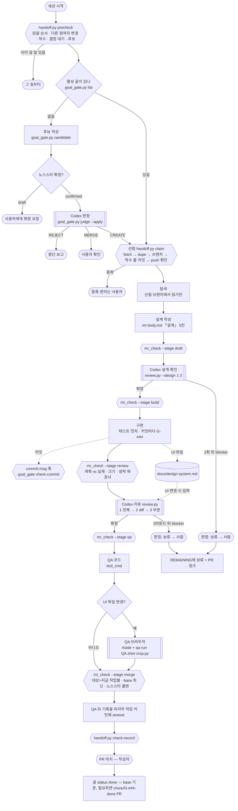

# 스킬 호출 구조

vibe-flow는 흐름의 주인이고, 판단은 Codex·브라우저·기계 게이트에, 기록은 핸드오프 스킬에 맡긴다. 형식은 [structure.md](structure.md).

## 상태와 호출

`[[ ]]`는 바깥 판단(Codex·브라우저), `{{ }}`는 기계 게이트, `( )`는 사람에게 넘기는 지점이다.

## 상태별 호출 표

| 상태 | 부르는 것 | 종류 | 무엇을 위해 |
|---|---|---|---|
| 사전체크 | `handoff.py precheck` → team-handoff / session-handoff 읽기 순서 | 스크립트 + **핸드오프 스킬** | 다른 참여자 변경·착수·보류·후보를 먼저 본다 |
| 골 확인·생성 | `goal_gate.py list` / `candidate` → `judge --apply` | 스크립트 + **Codex CLI** | 노스스타(확정본) 대조 판정 |
| (전 단계) 커밋 | `.git/hooks/commit-msg` → `goal_gate.py check-commit` | **git 훅** | 골 ID 없는 커밋 거부 |
| 선점 | `handoff.py claim` → `dupe.py` | 스크립트 | 같은 골·비슷한 착수·후보 차단/경고, 착수 줄 push |
| 선점 확인 | `mr_check.py --stage claim` | 스크립트 | 골·브랜치 규칙·중복 |
| 설계 | `mr_check.py --stage draft` | 스크립트 | 계약 + 설계 다섯 칸 |
| 설계 확인 | `review.py --design` | 스크립트 + **Codex CLI** | 구현 전 접근 방식 검증 (2회) |
| 구현 시작 | `mr_check.py --stage build` | 스크립트 | 설계 확정(또는 작은 변경 생략) |
| 리뷰 전 | `mr_check.py --stage review` | 스크립트 | 계획 vs 실제, 크기 경고, 생략 재검사 |
| 리뷰 | `review.py --round` | 스크립트 + **Codex CLI** | 3라운드 수렴 리뷰 |
| QA 전 | `mr_check.py --stage qa` | 스크립트 | 리뷰 확정 |
| QA 코드 | `test_cmd` (없으면 `syntax_check.py`) | 레포 테스트 | 회귀 |
| QA 브라우저 | **Aside** + **qa-run**의 `QA.shot`·`crop.py` | 스킬·브라우저 | UI 변경 시 실제 화면 증거 |
| 머지 전 | `mr_check.py --stage merge` | 스크립트 | QA 대상 = 지금 작업물, base 최신, 노스스타 불변 |
| 기록 | WORKLOG·INDEX·REMAINING (**team-handoff** 형식) → `handoff.py check-record` | 스킬 + 스크립트 | 작업과 같은 커밋, 작성자·골 ID 표기 |
| 보류·무인 멈춤 | REMAINING | 스킬 | 사람에게 넘길 것 |
| 요청자 확인 페이지 | **qa-run** (선택) | 스킬 | 비개발자용 QA 페이지 |
| 장시간 무인 | **autopilot** | 스킬 | vibe-flow 상태 전환 조건을 그대로 따름 |
| 큰 방향 결정 | **debate** (선택) | 스킬 + Codex | 노스스타 개정 같은 결정 |

## 누가 무엇을 판단하나

| 판단 | 판단자 | 구현 에이전트의 몫 |
|---|---|---|
| 노스스타 확정·개정 | 사용자 | 초안 작성, 필요성 보고 |
| 새 골을 만들까 | Codex (`judge`) | 후보 네 칸 작성 |
| 이 일을 집어도 되나 | `dupe` (착수 표시·브랜치·후보) | 선점 실행, 중복이면 멈춤 |
| 설계가 맞나 | Codex (`review.py --design`) + 2회 뒤 사람 | 설계 작성, 지적 반영 |
| 리뷰 통과인가 | Codex (`review.py`) + 3라운드 뒤 사람 | 근거 없는 blocker 확인, 수정 |
| QA 통과인가 | 테스트·Aside 결과 + `mr_check` | 실행하고 증거 기록 |
| 기록이 됐나 | `check-record` | 작업과 같은 커밋에 기록 |
| 게이트 우회 | 사용자 (직접 실행) | 빠른 준수 경로와 명령 제시 |
